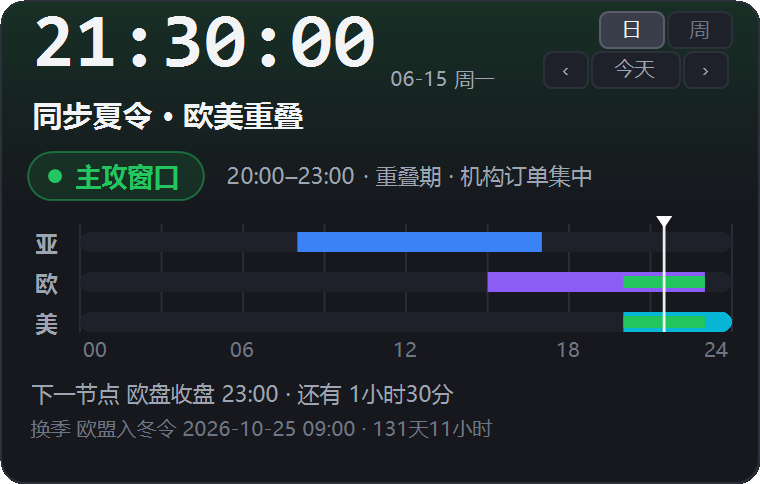

# 交易时钟 · SMC 桌面小窗

一个常驻 Windows 桌面的小窗，回答三个问题：**现在是谁的班、能不能下单、下一个节点还有多久。**

- 无依赖：系统自带 .NET Framework 4.8 编译运行，不装 Node / Electron / SDK
- 单文件：`dist\TradingClock.exe`，约 45 KB，拷到哪都能跑
- 只看不提醒：没有通知和声音，纯视觉
- 时间轴画的是**这一天真实能交易的时间**，周末、节假日自动留空
- **日视图 / 周视图**可切换，能前后翻页看明天、下周，翻页后不显示"现在"标记



---

## 快速开始

```
双击 dist\TradingClock.exe
```

重新构建（改了源码之后）：

```powershell
.\build.ps1
```

会用 `C:\Windows\Microsoft.NET\Framework64\v4.0.30319\csc.exe` 编译，跑 **129 项**引擎测试，并把 17 张界面预览图输出到 `preview\`。

---

## 界面怎么读

```
21:30:00                          [日][周]   ← 视图切换
06-15 周一                     ‹  今天  ›   ← 翻页 / 回今天（琥珀色=不是今天）
同步夏令 · 欧美重叠                感恩节   ← 盘面配置 + 当前窗口 +（有假日时）假日名
● 主攻窗口   20:00–23:00 · 重叠期 · 机构订单集中
亚 ▓▓▓▓░░░░░░░░░░░░░░░░░░
欧 ░░░░░▓▓▓▓▓▓▓▓░░░░░░░░░
美 ░░░░░░░░░░░▓▓▓▓▓▓▓▓▓▓░
              ▲                  ← 只在「今天」才画
下一节点 欧盘收盘 23:00 · 还有 1小时30分
换季 欧盟入冬令 2026-10-25 09:00 · 131天
```

- **光晕颜色 = 许可等级**：绿能打、黄试单、蓝布局、橙轻仓、红别碰、灰休市
- **时间轴**：亚（蓝）/ 欧（紫）/ 美（青）三条，跨零点的美盘在两端各画一段
- **重叠窗口**细条：同步期绿、错位期黄；变暗说明那天有假日
- **假日名**出现在标题行右侧，琥珀色

## 五档许可

| 颜色 | 场景 | 指令 |
|---|---|---|
| 🟢 绿 | 同步夏令 / 同步冬令的重叠期 | 主攻，BOS/CHoCH/FVG 主战场 |
| 🟡 黄 | 欧盘独走 | 试单，吃亚盘流动性 |
| 🔵 蓝 | 亚盘 | 布局，画结构等埋伏 |
| 🟠 橙 | 错位期重叠 / 美盘独走 / 空窗 / **节假日** | 轻仓或观望 |
| 🔴 红 | 错位期（重叠之外） | 禁止开新单 |
| ⚫ 灰 | 周末 / 全休假日 | 等开盘 |

---

## 日视图 / 周视图

右上角两个按钮切换，`‹ ›` 翻页，滚轮也能翻。

### 日视图

一天 24 小时，亚 / 欧 / 美 三条轨道。看的是「这一天几点能交易」。

### 周视图

7 行（周一到周日）× 24 列的小格子，一眼看到整周的骨架：

| 颜色 | 含义 |
|---|---|
| 蓝 | 亚盘 |
| 紫 | 欧盘 |
| 青 | 美盘 |
| 绿（错位期为黄） | 欧美重叠 |
| 深灰 | 不能交易 |

- 周一那行从 08:00 才开始（周一 06:00 才开盘），所以它没有凌晨那段青色
- 周二到周五凌晨有青色，那是前一天的尾盘
- 周六只有 00:00–06:00 一小段青色，周日整行空

### 翻页与"现在"标记

| 你在看 | 画不画现在标记 | 顶部状态 |
|---|---|---|
| 今天 / 本周 | 画（白线 + 三角） | 实时：`同步冬令 · 休市` |
| 明天 / 下周 / 任何非当前范围 | **不画** | 灰章：`预览 · 仅时间表 · 非实时` |

翻到非今日时，日期会变成琥珀色，等级徽章变成灰色的「预览」，避免把预览当成实时状态看。

---

## 周末与节假日（时间轴留空规则）

**原则：进度条 = 真实可交易的时间。不能交易的地方直接不画。**

### 周末

| 时段 | 画什么 |
|---|---|
| 周六 00:00–05:00/06:00 | 画，那是周五美盘的尾盘，真能交易 |
| 周六白天到周日全天 | 全空 |
| 周一 00:00–05:00/06:00 | 全空，市场还没开 |
| 周一 05:00/06:00 起 | 正常 |

逐分钟判断该市场当时是否真的开市，跨零点的美盘拆成「昨天尾段 + 今天晚段」分别算，中间的空档不会误画。

### 节假日分两级

| 级别 | 表现 | 覆盖 |
|---|---|---|
| **全休**（进度条留空 + ⚫休市） | 该市场当天不开 | 元旦、耶稣受难日、圣诞节、节礼日 |
| **清淡**（进度条变暗 + 等级降为轻仓） | 市场开着但流动性差 | 美国其他联邦假日、英国银行假日、中国全部假日 |

为什么要分两级：感恩节、马丁路德金日这些，外汇其实还开着，只是银行休息、点差变大、金属常提前收盘。直接标成"休市"会误导你去关单；标成"清淡 + 轻仓"才是可执行的信息。真·全场休市只有元旦、受难日、圣诞这几个。

### 已内置的假日

- **美国**（按规则算，任意年份）：元旦、马丁路德金日、总统日、耶稣受难日、阵亡将士纪念日、六月节、独立日、劳动节、感恩节、圣诞节（周六提前、周日推后）
- **欧洲/伦敦**（按规则算）：元旦、耶稣受难日、复活节星期一、五月初、春季、夏季银行假日、圣诞、节礼日
- **中国**（农历节日无法用公历推导，用内置表）：2027 年全部假期（原文为[国办发明电〔2026〕10 号](https://www.gov.cn/zhengce/content/202611/content_7085101.htm)：春节 2/5–2/13、清明 4/3–4/5、劳动 5/1–5/5、端午 6/9、中秋 9/15、国庆 10/1–10/7）；2028 只有固定日期的节日

### 补未来年份的假日

每年 11 月国务院发布次年放假安排后，改 **`holidays.txt`**（和 exe 放一起），不用重新编译：

```
# 格式：yyyy-MM-dd, 市场(CN|EU|US), 名称[, CLOSED]
2028-01-26, CN, 春节
2028-05-28, CN, 端午节
2028-10-03, CN, 中秋节
2028-11-23, US, 临时休市, CLOSED
```

不加 `CLOSED` 就是清淡（降级轻仓），加了就是当天不开（进度条留空）。改完重启小窗生效。

---

## 时间规则（重点：切换日期每年都不一样）

判定不靠硬编码日期，靠两条规则现算：

| | 进入夏令时 | 退出夏令时 |
|---|---|---|
| 美国 | 3 月 **第 2 个** 周日 15:00（北京） | 11 月 **第 1 个** 周日 14:00（北京） |
| 欧盟 | 3 月 **最后 1 个** 周日 09:00（北京） | 10 月 **最后 1 个** 周日 09:00（北京） |

**所以：**

1. 日期逐年漂移。2026 是美国 3/8、欧盟 3/29；2027 就变成 3/14 和 3/28。写死日期的代码到明年就错。
2. 欧美两边规则不同，所以每年必然有两段时间错位。
3. **春季错位 2～3 周（14 或 21 天），秋季错位永远正好 7 天。**
4. 四个切换时刻全在周日，外汇当时休市——切换本身盘中感知不到，你感知到的是**周一开盘时整个时间表已经换了**。

### 只看 3 种盘面配置

| 配置 | 欧盘（北京） | 美盘（北京） | 重叠 |
|---|---|---|---|
| A 双夏令 | 15:00–23:00 | 20:00–05:00 | 20:00–23:00（3h） |
| B 双冬令 | 16:00–00:00 | 21:00–06:00 | 21:00–00:00（3h） |
| C 错位 | 16:00–00:00 | 20:00–05:00 | 20:00–00:00（**4h**） |

> 错位期的重叠窗口其实是 **4 小时**，比同步期的 3 小时更长。它危险不是因为窗口短，而是因为长而脏——流动性断层、假突破多。

### 逐年对照

| 年份 | 美入夏令 | 欧入夏令 | 春季错位 | 欧入冬令 | 美入冬令 | 秋季错位 |
|---|---|---|---|---|---|---|
| 2024 | 03-10 | 03-31 | 21 天 | 10-27 | 11-03 | 7 天 |
| 2025 | 03-09 | 03-30 | 21 天 | 10-26 | 11-02 | 7 天 |
| 2026 | 03-08 | 03-29 | 21 天 | 10-25 | 11-01 | 7 天 |
| 2027 | 03-14 | 03-28 | 14 天 | 10-31 | 11-07 | 7 天 |
| 2028 | 03-12 | 03-26 | 14 天 | 10-29 | 11-05 | 7 天 |
| 2029 | 03-11 | 03-25 | 14 天 | 10-28 | 11-04 | 7 天 |
| 2030 | 03-10 | 03-31 | 21 天 | 10-27 | 11-03 | 7 天 |

亚盘全年固定 08:00–17:00，中国无夏令时，不参与切换。

---

## 操作

| 动作 | 效果 |
|---|---|
| 点 `日` / `周` | 切换视图 |
| 点 `‹` / `›` | 前一天 / 后一天，或前一周 / 后一周 |
| 点 `今天` / `本周` | 回到当前 |
| 滚轮 | 同上，快速翻页 |
| 按住左键拖 | 移动窗口，松手记住位置 |
| 右键 | 置顶 / 不透明度 / 开机自启 / 回到今天 / 切换视图 / 回到右上角 / 立即刷新 / 退出 |
| 双击 | 切换置顶（点在按钮上不会误触） |
| 点托盘图标 | 显示或隐藏 |
| 关闭窗口 | 收进托盘，不退出 |

配置存在 `%APPDATA%\TradingClock\config.ini`。
开机自启写在 `HKCU\Software\Microsoft\Windows\CurrentVersion\Run`，菜单里随时可关。

---

## 验证状态

**已验证**
- 引擎 **129 项断言全过**，覆盖：
  - 逐年切换日期、切换前后一分钟、2027 不被 2026 日期污染
  - 三配置窗口、五档许可、周末与周一开盘、跨零点倒计时
  - 周六/周日时间轴留空，但周六凌晨保留周五尾盘；周一凌晨不误画前一天尾巴
  - 感恩节 → 清淡（只有晚间那段变暗）；元旦、受难日 → 全场休市；国庆、春节 → 只有亚盘变暗
  - 休市日不再提示该市场的开盘节点
  - 日视图 +1 天：不显示现在标记、日期正确、可交易小时数正确
  - 周视图：周一起算、7×24 网格、格子内容（周一 01:00 空、21:00 重叠、周六 12:00 空、周六 02:00 仍是周五尾盘）、下周不显示现在标记
- 界面用**离屏渲染**出图核对，17 张在 `preview\`

**没验证**
- 窗口在这边弹不出来：沙箱环境无法启动 GUI 子系统程序（最小 winexe 也跑不起来）。"双击能开、按钮能点、置顶生效、托盘可用"需要你本机确认一次。引擎和绘制是纯逻辑，出问题只会在外壳层。

**已知限制**
- 中国的农历节日（春节/端午/中秋）靠表，2028 年只内置了固定日期的节日
- 亚盘按东京/香港时段处理，中国放假只算清淡，不算停市
- 周视图一格里 1 小时，边界不会错（所有开盘收盘都在整点），但不区分亚盘与欧盘同时开市的 15:00–17:00（优先显示欧盘）
- 无点击穿透，会挡住一小块图表
- exe 无数字签名，首次运行 SmartScreen 可能提示一次

## 目录

```
trading_clock/
  build.ps1                 一键构建
  holidays.txt              自定义假日（会复制到 dist）
  dist/TradingClock.exe     成品
  src/
    Program.cs              入口、单实例、错误日志
    SessionRules.cs         夏令时切换规则
    HolidayRules.cs         节假日规则（美国/欧洲按规则算，中国用表）
    TimeEngine.cs           判定：开市状态/许可/倒计时/日与周的时间轴
    WidgetRenderer.cs       纯绘制，可离屏渲染
    WidgetForm.cs           窗口外壳：置顶/拖动/托盘/翻页
    Config.cs               配置与开机自启
  tests/EngineTests.cs      129 项断言
  tools/Preview.cs          离屏出图
  preview/                  界面预览图
```

## 下一步

- 三交易员视角切换 + 本班任务清单 + 交班卡
- 全年切换日历弹窗
- 点击穿透、mini 折叠成一条
- 悉尼盘作为第四段
